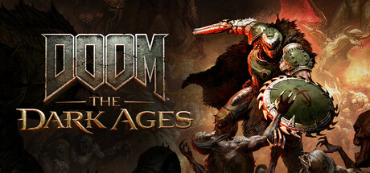

**DOOM: The Dark Ages by id Software (2025) is the third entry in the rebooted DOOM trilogy.**

---

## 📖 About

DOOM: The Dark Ages by id Software (2025) is the third entry in the rebooted DOOM trilogy. Set in a medieval cosmic war, the Slayer wields a shield saw and rides dragons alongside brutal combat. Its parry system and wave-based encounter design demand more engagement than the run-and-gun of Eternal.

## ⚠️ Problems Without Trainer

| Problem | Status |
|---------|--------|
| Shield parry timing window extremely tight against fast Atlan enemy projectiles | ✅ Solved |
| Dragon riding combat sections penalize missed aerial pickups heavily | ✅ Solved |
| Nightmare difficulty encounters layer multiple heavy enemy types simultaneously | ✅ Solved |
| Mastery upgrade requirements demand specific execution kill methods per enemy | ✅ Solved |
| Sentinel armor challenges time limited encounters with specific weapon restrictions | ✅ Solved |

## ✅ Solution

The **DOOM: The Dark Ages Trainer** solves all these issues, giving you complete control so you can focus on enjoying the game.

## 🎯 Features

- Unlimited Resources / Currency
- God Mode / Invincibility
- Instant Skill & Ability Cooldown
- One-Hit Kill
- Freeze Timers
- Unlock All Items & Achievements
- Custom Speed Multiplier
- Infinite Stamina / Energy

## 🚀 Quick Start

1. **Disable Windows Defender** temporarily (trainer may trigger false positive)
2. Get the trainer from the button above
3. Launch DOOM: The Dark Ages
4. Run the trainer as Administrator
5. Use the hotkeys to activate cheats in-game

## 💎 Free vs Pro

| Feature | Free | Pro |
|---------|------|-----|
| God Mode | ✅ | ✅ |
| Unlimited Resources | ✅ | ✅ |
| Advanced Cheats | ❌ | ✅ |
| Auto-Updates | ❌ | ✅ |
| Priority Support | ❌ | ✅ |

## 💻 Requirements

- Windows 10 / 11 (64-bit)
- DOOM: The Dark Ages (any version)
- .NET Framework 4.8+
- DirectX 11+

## 🍎 macOS

## ⚖️ Legal

Educational and single-player use only.

---

